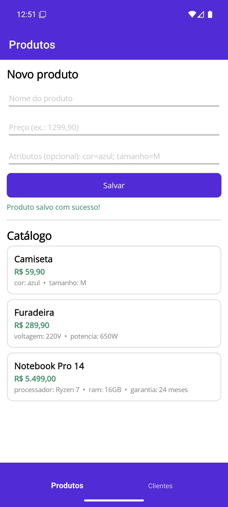
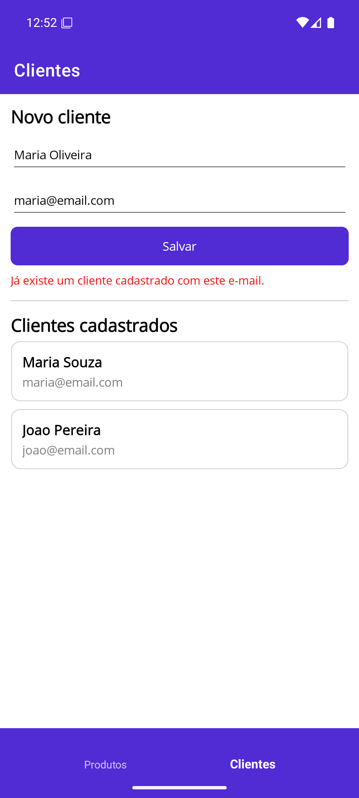
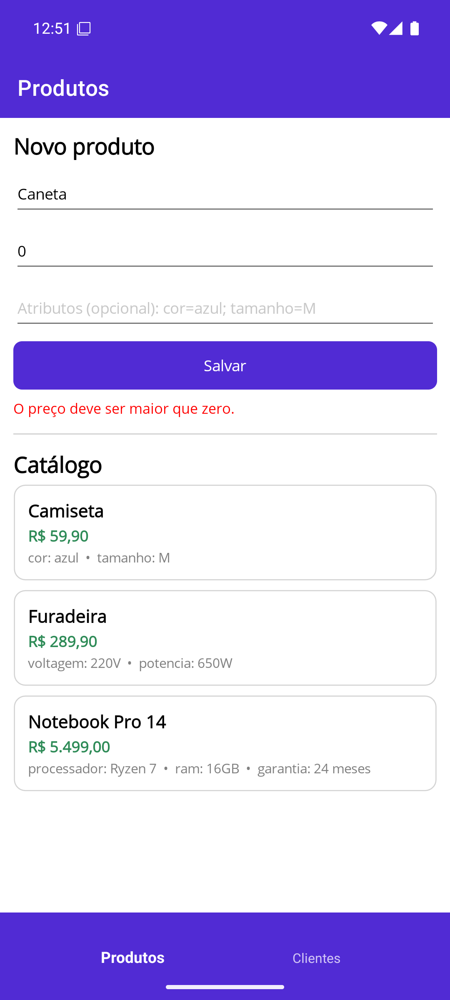

# EasyShop — Persistência Poliglota em .NET MAUI

## 👥 Integrantes

- Hygor Ferreira Barbosa
- Kauan Teodoro Lucio
- Elenara Caroline Xavier

## 📖 Descrição do projeto

O **EasyShop** é um protótipo de mini e-commerce em **.NET MAUI (.NET 10)** para Android. O app tem duas abas:

- **Produtos** — cadastro e listagem do catálogo, com atributos dinâmicos (ex.: `cor=azul; tamanho=M`).
- **Clientes** — cadastro e listagem de clientes (nome completo e e-mail).

O app antigo da EasyShop guardava tudo em um único banco relacional, o que obrigava a alterar o schema a cada nova categoria de produto. Este protótipo resolve isso separando os dados em dois bancos locais, cada um adequado ao tipo de dado.

## 🧠 Persistência Poliglota

Persistência poliglota é usar **mais de um paradigma de banco de dados na mesma aplicação**, escolhendo o melhor para cada tipo de dado.

| Dado | Natureza | Banco | Tecnologia | Por quê |
|------|----------|-------|------------|---------|
| **Clientes** | Estruturado, com regras estritas | **SQL (relacional)** | SQLite (`sqlite-net-pcl`) | Tabela de schema fixo, chave primária autoincremento, e-mail `UNIQUE` e campos `NOT NULL` garantidos pelo próprio banco |
| **Produtos** | Semi-estruturado: cada produto tem atributos diferentes | **NoSQL (documentos)** | LiteDB | Cada produto é um documento com um dicionário livre de atributos; novas categorias não exigem alterar o schema |

## 🏗️ Arquitetura em camadas

```
┌─────────────────────────────────────────────────────────┐
│  APRESENTAÇÃO      Views (XAML) + ViewModels            │
│                    (só conhecem as interfaces de serviço)│
├─────────────────────────────────────────────────────────┤
│  NEGÓCIO           ICustomerService / IProductService   │
│                    (validações e regras)                │
├─────────────────────────────────────────────────────────┤
│  ACESSO A DADOS    Repositories                         │
│                    ├─ Clientes → SQLite  (SQL)          │
│                    └─ Produtos → LiteDB  (NoSQL)        │
└─────────────────────────────────────────────────────────┘
          dependências sempre apontam para baixo
```

**Regra do grupo:** as Views e ViewModels **nunca** referenciam banco de dados (nenhum `using SQLite;` ou `using LiteDB;`). Elas recebem apenas `ICustomerService` / `IProductService` por injeção de dependência.

### Estrutura de pastas

```
EasyShop/
├── Models/              Customer (tabela SQLite), Product (documento LiteDB)
├── Data/                CustomerRepository (SQLite), ProductRepository (LiteDB)
├── Services/            CustomerService, ProductService (regras de negócio)
│   └── Interfaces/      ICustomerService, IProductService (contrato entre as camadas)
├── ViewModels/          ProductsViewModel, CustomersViewModel, ProductItem
├── Views/               ProductsPage, CustomersPage
├── Platforms/Android/
├── AppShell.xaml        TabBar com as abas Produtos e Clientes
└── MauiProgram.cs       Injeção de dependência
```

## ▶️ Como rodar

**Pré-requisitos**
- [.NET 10 SDK](https://dotnet.microsoft.com/download/dotnet/10.0)
- Workload do MAUI para Android: `dotnet workload install maui-android`
- Android SDK e um emulador Android (Visual Studio 2022 ou Android Studio)

**Passos**
```bash
git clone https://github.com/xeresgor/EasyShop.git
cd EasyShop
dotnet restore
dotnet build -t:Run -f net10.0-android
```
Com o emulador já iniciado. No Visual Studio: selecione o emulador e pressione **F5**.

### Onde ficam os dados no aparelho

Os dois bancos são arquivos locais em `FileSystem.AppDataDirectory`:

| Arquivo | Banco | Conteúdo |
|---|---|---|
| `easyshop.db3` | SQLite | Tabela `Customers` |
| `products.db` | LiteDB | Coleção `products` (documentos BSON) |

Para provar a persistência: cadastre clientes e produtos, feche o app por completo e abra de novo — as listas continuam lá.

## 🖼️ Prints

| Aba Produtos | Aba Clientes |
|:---:|:---:|
|  |  |

| Validação de erro | Lista atualizada após salvar |
|:---:|:---:|
|  |  |

## 🎥 Vídeo de demonstração

[Link do vídeo (YouTube ou Google Drive)](COLE_O_LINK_AQUI)
